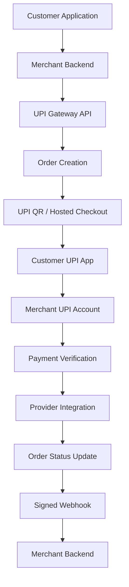

# 🏦 UPI Gateway

<h3 align="center">A Multi-Merchant UPI Payment Gateway</h3>

<p align="center">
  A self-hosted payment infrastructure for Indian merchants, featuring dynamic UPI QR codes, payment verification, account rotation, and secure webhook notifications.
</p>

<p align="center">
  
  
  
  
</p>

<p align="center">
  <a href="#-features">Features</a> ·
  <a href="#-screenshots">Screenshots</a> ·
  <a href="#-architecture">Architecture</a> ·
  <a href="#-installation">Installation</a> ·
  <a href="#-api-reference">API Reference</a>
</p>

---


## 🚀 What's Coming Next?

<div align="center">

### We're Working on Something Better!

The initial version of our UPI Gateway is already available on GitHub.

Now we're preparing the next phase of development — bringing improvements, new capabilities, better reliability and a more polished developer experience.

**What's ahead?**

- ⚡ Enhanced Payment Processing
- 🔐 Improved Security & Validation
- 🔌 Better API Integration
- 📊 Improved Dashboard & Analytics
- 🛠️ Performance Optimizations
- 📚 Better Documentation

<br/>


### Stay Tuned!

We're building on the existing foundation, one improvement at a time.

**The next update is coming soon.**

</div>
## 📖 Overview

UPI Gateway is a self-hosted, multi-merchant payment management platform designed for businesses that want to integrate UPI payments into their applications.

Each merchant can configure their own UPI accounts, generate dynamic payment QR codes, track transactions, and receive automated payment notifications.

**Payments are intended to go directly to the configured merchant UPI accounts. The platform is not designed to hold or pool merchant funds.**

### Key Capabilities

- Multi-merchant account management
- Dynamic UPI QR generation
- Automated payment verification integrations
- Multiple UPI account rotation
- Secure HMAC-SHA256 webhook signatures
- Manual UTR verification fallback
- Merchant API authentication
- Centralized administration dashboard

---

## 📸 Screenshots

### Homepage
<p align="center">
  
</p>

### Features
<p align="center">
  
</p>

### API Documentation
<p align="center">
  
</p>

### Admin Dashboard
<p align="center">
  
</p>

### Payment Account Management
<p align="center">
  
</p>

### Customer Payment Experience

<table>
  <tr>
    <td width="50%">
      <p align="center"><b>Payment Page</b></p>
      
    </td>
    <td width="50%">
      <p align="center"><b>Payment Verification</b></p>
      
    </td>
  </tr>
  <tr>
    <td colspan="2">
      <p align="center"><b>Payment Success</b></p>
      
    </td>
  </tr>
</table>

---

## ✨ Features

### 🏢 Multi-Merchant Management
- Independent merchant accounts.
- Merchant-specific API credentials.
- Individual UPI payment account configuration.
- Centralized administration and monitoring.

### 📱 Dynamic UPI Payments
- Dynamic UPI payment QR generation.
- Unique transaction reference for every order.
- Hosted checkout and payment pages.
- UPI intent integration.

### 🔄 Payment Verification
- Paytm for Business verification integration.
- Paytm Payment Gateway integration.
- PhonePe Payment Gateway integration.
- Manual UTR verification fallback.

### ⚖️ UPI Account Rotation
- Configure multiple UPI accounts.
- Distribute payment requests across configured accounts.
- Account-level daily limits.
- Merchant-specific account management.

### 🔔 Webhook Notifications
- HMAC-SHA256 request signatures.
- `order.paid` event.
- `order.expired` event.
- Webhook delivery logs.
- Retry handling.

### 🛡️ Security & Administration
- API key and secret authentication.
- Merchant isolation.
- Transaction monitoring.
- Admin dashboard.
- Payment verification history.

---

## 🏗️ System Architecture



### Payment Lifecycle

1. Merchant creates a payment order through the API.
2. Gateway generates a unique order reference and payment URL.
3. Customer scans the QR code or opens a UPI intent.
4. Customer completes the payment using their UPI application.
5. Gateway checks payment status through the configured verification integration.
6. Order status is updated after successful verification.
7. Merchant receives a signed webhook notification.

---

## ⚙️ Technology Stack

<p align="center">
  
</p>

| Component | Technology |
|---|---|
| Backend Framework | Laravel 12 |
| Programming Language | PHP 8.2+ |
| Database | MySQL 8.x (mandatory) |
| Frontend | Blade / JavaScript |
| Queue Processing | Laravel Queue |
| API Authentication | API Key & Secret |
| Webhook Security | HMAC-SHA256 |
| Web Server | Nginx |
| Process Management | Supervisor |
| Build Tools | Composer, Node.js, NPM |

---

## 🚀 Installation

### Requirements

- PHP 8.2 or newer
- Composer
- Node.js 18+
- NPM
- MySQL 8.x or MariaDB 10.x/11.x (verify against your hosting image before deployment)
- Required PHP extensions for Laravel 12

### 1. Clone Repository

```bash
git clone https://github.com/mynkdev-21/upi-gateway.git

cd upi-gateway
```

### 2. Install Dependencies

```bash
composer install

npm install
```

### 3. Configure Environment

```bash
cp .env.example .env

php artisan key:generate
```

### 4. Configure Database

For MySQL, configure your `.env` file before running migrations. SQLite is not supported by the application installer or runtime.

### 5. Create Administrator

```bash
php artisan app:create-admin you@example.com
```

### 6. Start Development Server

```bash
composer run dev
```

Access the application:

- Application: `http://127.0.0.1:8000`
- API Documentation: `http://127.0.0.1:8000/docs`

These are local development addresses, not public demo URLs.

---

## 🔐 Environment Configuration

Configure the following variables in your `.env` file.

| Variable | Description | Example |
|---|---|---|
| `APP_NAME` | Application name | UPI Gateway |
| `APP_ENV` | Application environment | production |
| `APP_DEBUG` | Debug mode | false |
| `APP_URL` | Application URL | https://example.com |
| `DB_CONNECTION` | Database driver | mysql |
| `DB_HOST` | Database host | 127.0.0.1 |
| `DB_DATABASE` | Database name | upi_gateway |
| `DB_USERNAME` | Database username | db_user |
| `DB_PASSWORD` | Database password | Strong password |
| `QUEUE_CONNECTION` | Queue driver | database |

Never commit production credentials or API secrets to GitHub.

---

## 🗄️ MySQL Configuration

Update your `.env` file:

```env
DB_CONNECTION=mysql
DB_HOST=127.0.0.1
DB_PORT=3306
DB_DATABASE=upi_gateway
DB_USERNAME=db_user
DB_PASSWORD=your_password
```

Run migrations:

```bash
php artisan migrate
```

---

## 🔌 Supported Payment Integrations

| Provider | Integration Type | Verification |
|---|---|---|
| Paytm for Business | UPI QR | Available |
| Paytm PG | Hosted Checkout | Official API |
| PhonePe PG | Hosted Checkout | Official API |
| Generic UPI ID | UPI QR | Manual UTR |

**Integration notes:**

- Paytm for Business verification currently uses an unofficial status API and may stop working without notice.
- Paytm PG and PhonePe PG integrations depend on their respective official API credentials and merchant configurations.
- Generic UPI accounts use manual transaction reference verification.

---

## 📡 API Reference

All merchant API requests require:

```http
X-Api-Key: key_xxx
X-Api-Secret: sec_xxx
```

### Available Endpoints

| Method | Endpoint | Description |
|---|---|---|
| POST | `/api/v1/orders` | Create payment order |
| GET | `/api/v1/orders/{id}` | Retrieve order status |
| GET | `/api/v1/accounts` | List configured UPI accounts |

Full API documentation is available at `/docs` when the application is running.

Sandbox credentials use the `test_key_...` / `test_sec_...` pair and create
internal TEST transactions only. Live and Sandbox credentials, orders, account
lists, webhook URLs, and financial totals are isolated.

### Create Payment Order

**Request:**

```bash
curl -X POST https://yourdomain.com/api/v1/orders \
  -H "X-Api-Key: key_xxx" \
  -H "X-Api-Secret: sec_xxx" \
  -H "Content-Type: application/json" \
  -d '{
    "amount": 199,
    "client_order_id": "INV1001"
  }'
```

**Example Response:**

```json
{
  "success": true,
  "data": {
    "order_id": "ORDAB12CD34EF56GH78",
    "client_order_id": "INV1001",
    "amount": "199.00",
    "currency": "INR",
    "status": "pending",
    "environment": "live",
    "test": false,
    "payment_url": "https://yourdomain.com/pay/ORDAB12CD34EF56GH78",
    "upi_intent": "upi://pay?pa=merchant@upi&am=199.00&tr=ORDAB12CD34EF56GH78",
    "expires_at": "2026-01-01T12:15:00+05:30"
  }
}
```

The response is illustrative; actual values depend on the application configuration.

---

## 🔔 Webhook Integration

Merchants can configure their webhook endpoint through:

**Dashboard → API & Webhooks**

Webhook events:

- `order.paid`
- `order.expired`
- `order.under_review`
- `order.failed` (Sandbox)
- `order.pending` (Sandbox)
- `order.timeout` (Sandbox)

Each webhook request includes an `X-Signature` header containing an HMAC-SHA256 signature of the raw request body.

### PHP Verification Example

```php
$body = file_get_contents('php://input');

$secret = getenv('PAYMENT_WEBHOOK_SECRET');

$expected = hash_hmac(
    'sha256',
    $body,
    $secret
);

$received = $_SERVER['HTTP_X_SIGNATURE'] ?? '';

if (!hash_equals($expected, $received)) {
    http_response_code(401);
    exit;
}

$event = json_decode($body, true);

switch ($event['event'] ?? '') {
    case 'order.paid':
        // Process successful payment
        break;

    case 'order.expired':
        // Process expired payment
        break;
}
```

## 🏭 Production Setup

### 1. Web Server (Nginx)

The example below includes HSTS, security headers for static files (mirroring
the Laravel `SecurityHeaders` middleware), and a php-fpm block.

```nginx
# Redirect plain HTTP → HTTPS
server {
    listen 80;
    server_name yourdomain.com;
    return 301 https://$host$request_uri;
}

server {
    listen 443 ssl;
    http2 on;
    server_name yourdomain.com;
    root /var/www/upi-gateway/public;
    index index.php;

    # ── TLS ──────────────────────────────────────────────────────────────────
    ssl_certificate     /etc/letsencrypt/live/yourdomain.com/fullchain.pem;
    ssl_certificate_key /etc/letsencrypt/live/yourdomain.com/privkey.pem;
    ssl_protocols       TLSv1.2 TLSv1.3;
    ssl_ciphers         ECDHE-ECDSA-AES128-GCM-SHA256:ECDHE-RSA-AES128-GCM-SHA256:ECDHE-ECDSA-AES256-GCM-SHA384:ECDHE-RSA-AES256-GCM-SHA384;
    ssl_prefer_server_ciphers off;
    ssl_session_cache   shared:SSL:10m;
    ssl_session_timeout 1d;

    # ── Security headers for all responses (including static files) ───────────
    # Dynamic PHP responses also get these from Laravel's SecurityHeaders
    # middleware; setting them here ensures static assets are covered too.
    add_header Strict-Transport-Security "max-age=31536000; includeSubDomains" always;
    add_header X-Content-Type-Options    "nosniff"                             always;
    add_header X-Frame-Options           "DENY"                                always;
    add_header Referrer-Policy           "strict-origin-when-cross-origin"     always;
    add_header Permissions-Policy        "camera=(), microphone=(), geolocation=()" always;
    # Content-Security-Policy is NOT set here because it contains a per-request
    # nonce generated by Laravel. Setting a static CSP at this level would
    # conflict with the nonce. Let the PHP middleware handle it.

    # ── Compiled Vite assets (immutable, long-lived cache) ────────────────────
    location /build/ {
        expires 1y;
        add_header Cache-Control "public, immutable";
        add_header X-Content-Type-Options "nosniff" always;
        add_header X-Frame-Options        "DENY"    always;
        try_files $uri =404;
    }

    # ── Routing ───────────────────────────────────────────────────────────────
    location / {
        try_files $uri $uri/ /index.php?$query_string;
    }

    # ── PHP-FPM ───────────────────────────────────────────────────────────────
    location ~ \.php$ {
        fastcgi_pass            unix:/var/run/php/php8.2-fpm.sock;
        fastcgi_param           SCRIPT_FILENAME $realpath_root$fastcgi_script_name;
        include                 fastcgi_params;
        fastcgi_hide_header     X-Powered-By;
        fastcgi_read_timeout    60s;
    }

    # ── Deny dotfiles (e.g. .env, .git) ──────────────────────────────────────
    location ~ /\.(?!well-known) {
        deny all;
    }
}
```

For production integrations, also implement replay protection, event idempotency, and secure secret storage.

---

## 🏭 Production Deployment

### Release checklist

Set `APP_ENV=production`, `APP_DEBUG=false`, a generated `APP_KEY`, an HTTPS
`APP_URL`, secure session cookies, and separate Live/Sandbox webhook URLs. Do
not include `.env`, database files, `storage` contents, logs, archives,
`vendor`, or `node_modules` in a release archive. Take a database backup before
running migrations.

The expiry compatibility migration keeps `orders.expires_at` nullable for
forward compatibility. Its rollback intentionally stops with an actionable
error when NULL rows exist; it never guesses an expiry or alters payment
history. Resolve those rows under an approved data policy, verify them, and
then rerun the rollback.

On cPanel, point the document root at `public/`, select PHP 8.2+, enable PDO,
PDO MySQL, cURL, mbstring, XML, OpenSSL, fileinfo, tokenizer, and
JSON, then use a cron entry for `schedule:run` and a managed process or cron
worker for `queue:work`. On a VPS, use PHP-FPM, Nginx or Apache, Supervisor or
systemd for the queue worker, TLS, restricted `storage` permissions, and
regular database backups.

### 1. Install Production Dependencies

```bash
composer install --no-dev --optimize-autoloader

npm install

npm run build
```

### 2. Configure Application

```env
APP_ENV=production
APP_DEBUG=false
APP_URL=https://yourdomain.com

DB_CONNECTION=mysql
DB_HOST=127.0.0.1
DB_DATABASE=upi_gateway
DB_USERNAME=db_user
DB_PASSWORD=strong_password

QUEUE_CONNECTION=database
SESSION_DRIVER=database
CACHE_STORE=database
```

### 3. Run Migrations

```bash
php artisan migrate --force
```

### 4. Optimize Laravel

```bash
php artisan config:cache

php artisan route:cache

php artisan view:cache
```

### 5. Nginx Configuration

```nginx
server {
    listen 80;
    server_name yourdomain.com;

    root /var/www/upi-gateway/public;
    index index.php;

    add_header X-Frame-Options "SAMEORIGIN";
    add_header X-Content-Type-Options "nosniff";

    location / {
        try_files $uri $uri/ /index.php?$query_string;
    }

    location ~ \.php$ {
        fastcgi_pass unix:/var/run/php/php8.2-fpm.sock;
        fastcgi_param SCRIPT_FILENAME $realpath_root$fastcgi_script_name;
        include fastcgi_params;
    }

    location ~ /\.(?!well-known).* {
        deny all;
    }
}
```

Configure HTTPS and a valid TLS certificate before accepting production traffic.

### 6. Queue Worker

Example Supervisor configuration:

```ini
[program:upi-gateway-worker]
process_name=%(program_name)s_%(process_num)02d
command=php /var/www/upi-gateway/artisan queue:work --sleep=3 --tries=3 --max-time=3600
autostart=true
autorestart=true
numprocs=2
redirect_stderr=true
stdout_logfile=/var/www/upi-gateway/storage/logs/worker.log
```

### 7. Scheduler

Add the following cron entry:

```cron
* * * * * cd /var/www/upi-gateway && php artisan schedule:run >> /dev/null 2>&1
```

---

## ➕ Adding a Payment Provider

The platform supports extending payment verification through provider-specific verifier implementations.

### Step 1: Create Verifier

Create:

`app/Services/Verifiers/YourProviderVerifier.php`

```php
class YourProviderVerifier implements Verifier
{
    public function check(Order $order): VerificationResult
    {
        // Call the provider's official API.

        // Return a verified payment result:
        // VerificationResult::paid(
        //     utr: '...',
        //     txnId: '...'
        // );

        // Or return a pending result:
        // VerificationResult::pending();
    }
}
```

### Step 2: Register Provider

Register the provider in `PaymentAccount::PROVIDERS`:

```php
'your_provider' => [
    'label'    => 'Your Provider',
    'verifier' => YourProviderVerifier::class,
    'hosted'   => false,
],
```

Use the provider's official API documentation and authentication requirements when implementing a new integration.

---

## 🔒 Security & Compliance

Security is an important part of payment infrastructure.

- Never store payment API secrets in source code.
- Use HTTPS for all production communication.
- Verify webhook signatures before processing events.
- Implement idempotency for payment and webhook processing.
- Verify payment status using trusted provider responses.
- Never treat a customer-submitted UTR as proof of payment.
- Restrict access to administrative endpoints.
- Maintain audit logs for payment-related operations.

### Legal Considerations

This software does not itself establish regulatory authorization to operate a payment service.

In India, payment aggregation and payment system activities may be subject to RBI regulations and other applicable requirements.

Before deploying this software commercially, obtain appropriate legal and regulatory advice and confirm that the payment flow, merchant arrangements, and provider integrations comply with applicable laws and provider terms.

---

## 🧪 Running Tests

Run the application test suite:

```bash
composer run test
```

---

## 📂 Project Structure

```text
upi-gateway/
│
├── app/
│   ├── Http/
│   ├── Models/
│   ├── Services/
│   │   └── Verifiers/
│   └── Jobs/
│
├── bootstrap/
├── config/
├── database/
├── public/
├── resources/
│   ├── views/
│   ├── css/
│   └── js/
├── routes/
├── screenshots/
├── storage/
├── tests/
├── .env.example
├── artisan
├── composer.json
└── package.json
```

This is a representative structure; adapt it to the actual repository layout.

---

## 📄 License

Distributed under the MIT License.

See the `LICENSE` file for details.

---

## 📬 Contact & Connect

Have a question, collaboration idea, business inquiry, or technical discussion? Feel free to get in touch.

<p align="center">
  <a href="mailto:mayanksingh3132@gmail.com">
    
  </a>
  <a href="https://linkedin.com/in/mynk-dev">
    
  </a>
  <a href="https://t.me/mayankdeveloper">
    
  </a>
  <a href="https://github.com/mynkdev-21">
    
  </a>
</p>

### 🌐 Professional Links

| Platform | Details |
|---|---|
| 📧 Email | mayanksingh3132@gmail.com |
| 🌐 Portfolio | [mayankdeveloper.site](https://mayankdeveloper.site) |
| 💼 LinkedIn | [linkedin.com/in/mynk-dev](https://linkedin.com/in/mynk-dev) |
| 🏢 Company | [amtechinfo.online](https://amtechinfo.online) |
| ✈️ Telegram | [@mayankdeveloper](https://t.me/mayankdeveloper) |
| 🐙 GitHub | [@mynkdev-21](https://github.com/mynkdev-21) |

---

<p align="center">
  <b>Have an idea? Let's build something great together.</b>
  <br/>
  <sub>Mayank Singh · Full Stack Developer · Founder @ AmTech INFO</sub>
</p>
---
## 👨‍💻 Author

**Mayank Singh**

Full Stack Developer · Android Engineer · Founder @ AmTech INFO

<p>
  <a href="https://github.com/mynkdev-21">
    
  </a>
  <a href="https://linkedin.com/in/mynk-dev">
    
  </a>
  <a href="https://mayankdeveloper.site">
    
  </a>
</p>

---

<p align="center">
  <b>Built with ❤️ for Indian merchants.</b>
  <br/>
  <sub>Designed and developed by Mayank Singh · AmTech INFO</sub>
</p>
