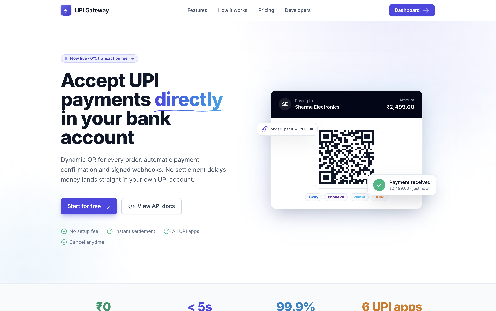
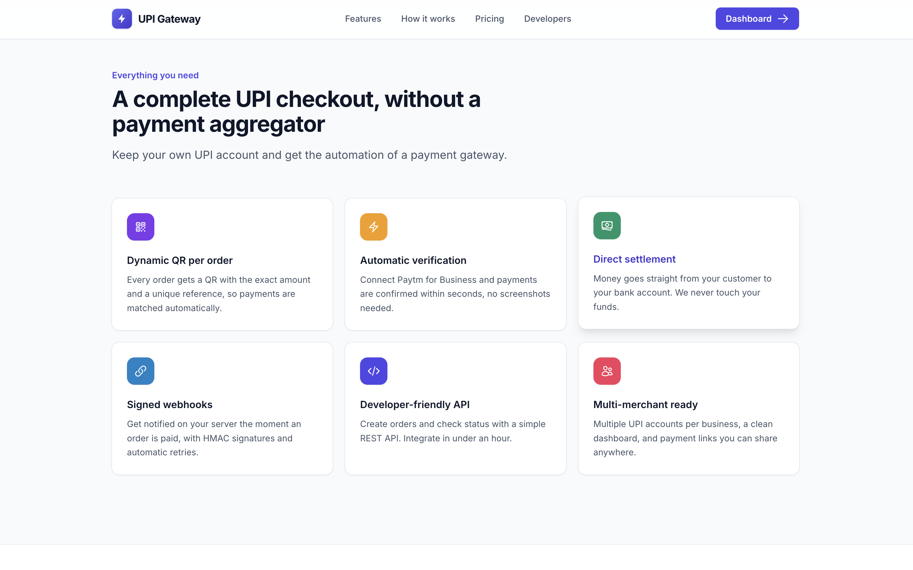
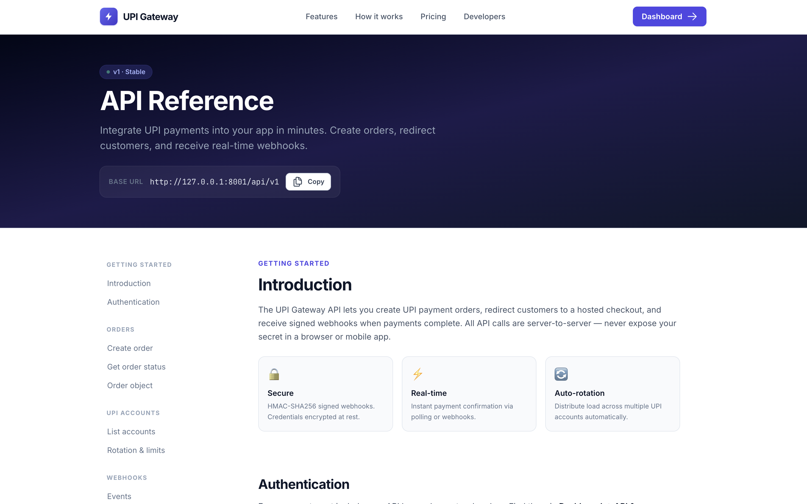
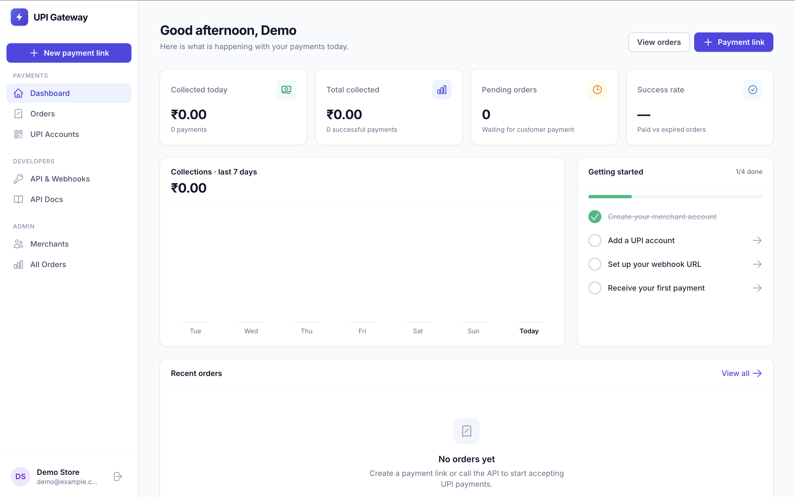
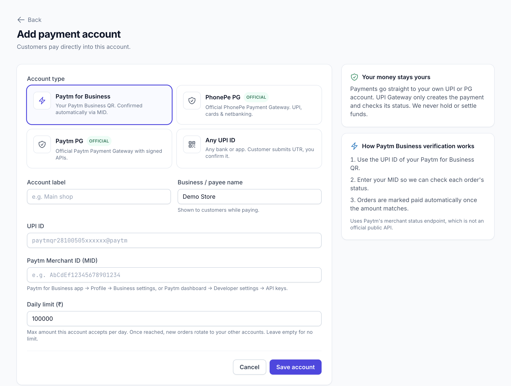
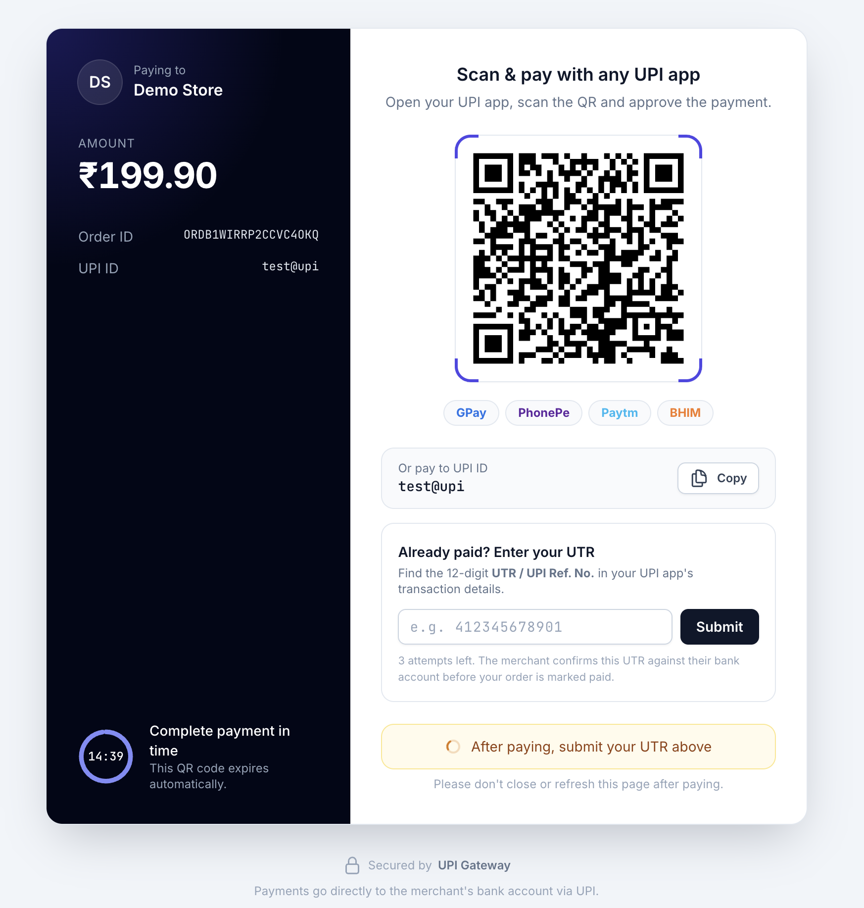
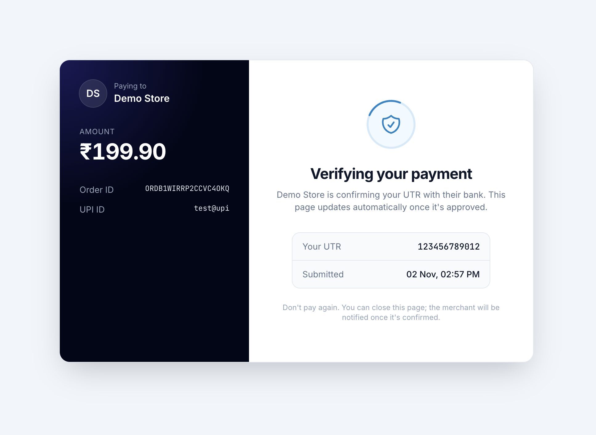
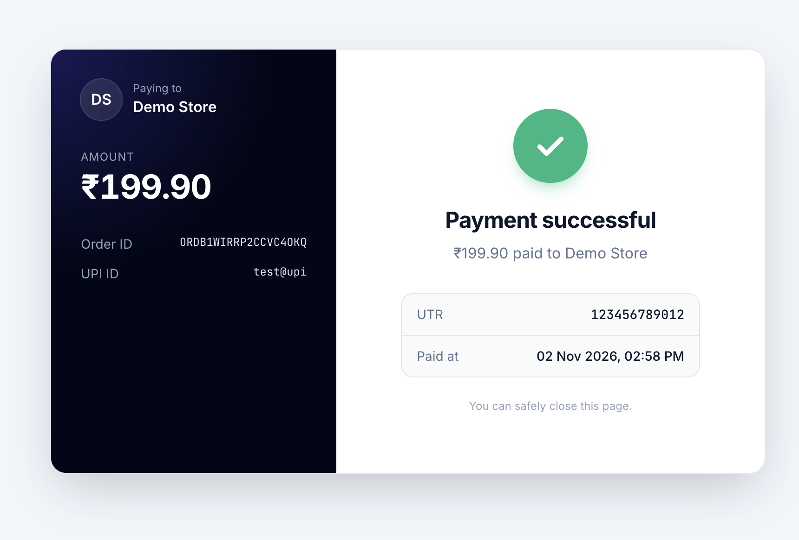

<div align="center">


# 🏦 UPI Gateway

**Multi-merchant UPI payment gateway with dynamic QR, auto-verification & signed webhooks.**

Payments go **directly to each merchant's own UPI account** — this app never holds funds.

[Live Demo](http://127.0.0.1:8000) · [API Docs](http://127.0.0.1:8000/docs) · [Report Bug](https://github.com/mynkdev-21/upi-gateway/issues)

</div>

---

## 📸 Screenshots

**Homepage**


**Features**


**API Docs**


**Admin Dashboard**


**Add Payment Account**


**Payment Page**


**Verifying Payment**


**Payment Success**


---

## ✨ Features

- 🔄 **Multi-merchant** — each merchant manages their own UPI accounts
- 📱 **Dynamic QR** — unique `upi://pay?...&tr=<order_no>` per order
- ✅ **Auto-verification** — Paytm for Business, Paytm PG, PhonePe PG
- 🔁 **Account rotation** — distribute load across multiple UPI accounts with daily limits
- 🔔 **Signed webhooks** — HMAC-SHA256 signed `order.paid` / `order.expired` events
- 🛡️ **Manual UTR fallback** — always available if auto-verify is down
- 🧾 **Admin panel** — manage merchants, orders, and webhook logs

---

## 🏗️ Architecture

```
Customer → POST /api/v1/orders → Dynamic QR / Hosted Checkout
                                        ↓
                              Customer pays via UPI app
                                        ↓
                         Polling / Background scheduler
                                        ↓
                         Provider API (Paytm / PhonePe)
                                        ↓
                    Order marked paid → Webhook → Merchant server
```

---

## 🚀 Quick Start

### Requirements

- PHP 8.2+
- Composer
- Node.js 18+
- SQLite (default) or MySQL 8.0+

### Installation

```bash
# 1. Clone the repo
git clone https://github.com/mynkdev-21/upi-gateway.git
cd upi-gateway

# 2. Install dependencies
composer install
npm install

# 3. Environment setup
cp .env.example .env
php artisan key:generate

# 4. Database setup
touch database/database.sqlite   # skip if using MySQL
php artisan migrate

# 5. Create admin account
php artisan app:create-admin you@example.com

# 6. Start development server
composer run dev
```

Open **http://127.0.0.1:8000** · API Docs at **http://127.0.0.1:8000/docs**

---

## ⚙️ Environment Variables

Key variables in `.env`:

| Variable | Description | Default |
|---|---|---|
| `APP_NAME` | Application name | `Laravel` |
| `APP_URL` | Your app URL | `http://localhost` |
| `DB_CONNECTION` | `sqlite` or `mysql` | `sqlite` |
| `DB_HOST` | MySQL host | `127.0.0.1` |
| `DB_DATABASE` | Database name | — |
| `DB_USERNAME` | Database user | — |
| `DB_PASSWORD` | Database password | — |
| `QUEUE_CONNECTION` | Queue driver | `database` |

---

## 🗄️ MySQL Setup (Production)

Update `.env`:

```env
DB_CONNECTION=mysql
DB_HOST=127.0.0.1
DB_PORT=3306
DB_DATABASE=upi_gateway
DB_USERNAME=root
DB_PASSWORD=your_password
```

Then run:

```bash
php artisan migrate
```

---

## 🔌 Supported Payment Providers

| Provider | Type | Auto-verify | Notes |
|---|---|---|---|
| **Paytm for Business** | UPI QR | ✅ | Uses unofficial status API — may break |
| **Paytm PG** | Hosted checkout | ✅ | Official Transaction Status API v3 |
| **PhonePe PG** | Hosted checkout | ✅ | Official API |
| **Any UPI ID** | UPI QR | ❌ | Manual UTR entry |

---

## 📡 API Overview

All endpoints require `X-Api-Key` and `X-Api-Secret` headers.

```
POST   /api/v1/orders              Create a new order
GET    /api/v1/orders/{id}         Get order status
GET    /api/v1/accounts            List UPI accounts
```

Full documentation at `/docs`.

### Create Order — Quick Example

```bash
curl -X POST https://yoursite.com/api/v1/orders \
  -H "X-Api-Key: key_xxx" \
  -H "X-Api-Secret: sec_xxx" \
  -H "Content-Type: application/json" \
  -d '{"amount": 199, "client_order_id": "INV1001"}'
```

```json
{
  "success": true,
  "data": {
    "order_id": "ORDAB12CD34EF56GH78",
    "amount": "199.00",
    "status": "pending",
    "payment_url": "https://yoursite.com/pay/ORDAB12CD34EF56GH78",
    "upi_intent": "upi://pay?pa=merchant@upi&am=199.00&tr=ORDAB12CD34EF56GH78",
    "expires_at": "2026-01-01T12:15:00+05:30"
  }
}
```

---

## 🔔 Webhooks

Set your endpoint in **Dashboard → API & Webhooks**. Every request includes an `X-Signature` header (HMAC-SHA256 of body with your API secret).

```php
$body     = file_get_contents('php://input');
$expected = hash_hmac('sha256', $body, 'your_api_secret');

if (!hash_equals($expected, $_SERVER['HTTP_X_SIGNATURE'] ?? '')) {
    http_response_code(401); exit;
}

$event = json_decode($body, true);
// $event['event'] === 'order.paid' or 'order.expired'
```

---

## 🏭 Production Setup

### 1. Web Server (Nginx)

```nginx
server {
    listen 80;
    server_name yourdomain.com;
    root /var/www/upi-gateway/public;

    add_header X-Frame-Options "SAMEORIGIN";
    add_header X-Content-Type-Options "nosniff";

    index index.php;

    location / {
        try_files $uri $uri/ /index.php?$query_string;
    }

    location ~ \.php$ {
        fastcgi_pass unix:/var/run/php/php8.2-fpm.sock;
        fastcgi_param SCRIPT_FILENAME $realpath_root$fastcgi_script_name;
        include fastcgi_params;
    }
}
```

### 2. Queue Worker (Supervisor)

```ini
[program:upi-gateway-worker]
process_name=%(program_name)s_%(process_num)02d
command=php /var/www/upi-gateway/artisan queue:work --sleep=3 --tries=3 --max-time=3600
autostart=true
autorestart=true
numprocs=2
redirect_stderr=true
stdout_logfile=/var/www/upi-gateway/storage/logs/worker.log
```

### 3. Scheduler (Cron)

```cron
* * * * * cd /var/www/upi-gateway && php artisan schedule:run >> /dev/null 2>&1
```

### 4. Production `.env`

```env
APP_ENV=production
APP_DEBUG=false
APP_URL=https://yourdomain.com

DB_CONNECTION=mysql
DB_HOST=127.0.0.1
DB_DATABASE=upi_gateway
DB_USERNAME=db_user
DB_PASSWORD=strong_password

QUEUE_CONNECTION=database
SESSION_DRIVER=database
CACHE_STORE=database
```

### 5. Optimize

```bash
composer install --no-dev --optimize-autoloader
php artisan config:cache
php artisan route:cache
php artisan view:cache
npm run build
```

---

## ➕ Adding a New Payment Provider

1. Create `app/Services/Verifiers/YourProviderVerifier.php` implementing `Verifier`:

```php
class YourProviderVerifier implements Verifier
{
    public function check(Order $order): VerificationResult
    {
        // Call your provider's API
        // Return VerificationResult::paid(utr: '...', txnId: '...')
        // or VerificationResult::pending()
    }
}
```

2. Register it in `PaymentAccount::PROVIDERS`:

```php
'your_provider' => [
    'label'    => 'Your Provider',
    'verifier' => YourProviderVerifier::class,
    'hosted'   => false,
],
```

---

## ⚠️ Legal Notice

- This app **never collects money** — payments go directly to each merchant's UPI account.
- Collecting payments on behalf of merchants makes you a **Payment Aggregator**, which requires **RBI authorisation**.
- Paytm for Business auto-verification uses an **unofficial API** that can break without notice. Manual UTR verification is always available as a fallback.

---

## 🧪 Running Tests

```bash
composer run test
```

---

## 📄 License

MIT © [Mayank Singh](https://github.com/mynkdev-21/)

---

## 📬 Contact

Kisi bhi query, collaboration ya support ke liye reach out karo:

| Platform | Link |
|---|---|
| 📧 Email | [mayanksingh3132@gmail.com](mailto:mayanksingh3132@gmail.com) |
| 🌐 Portfolio | [mayankdeveloper.site](https://mayankdeveloper.site) |
| 🏢 Company | [amtechinfo.online](https://amtechinfo.online) |
| ✈️ Telegram | [@mayankdeveloper](https://t.me/mayankdeveloper) |
| 🐙 GitHub | [@mynkdev-21](https://github.com/mynkdev-21/) |

---

<div align="center">
Built with ❤️ for Indian merchants by <a href="https://github.com/mynkdev-21/">Mayank Singh</a>
</div>
